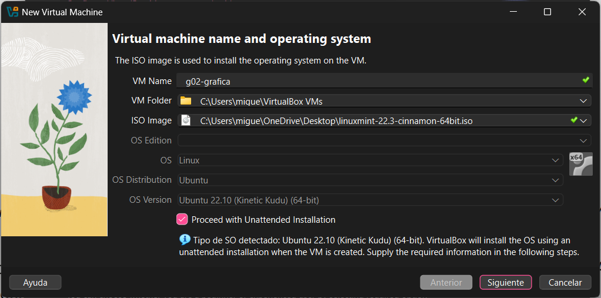
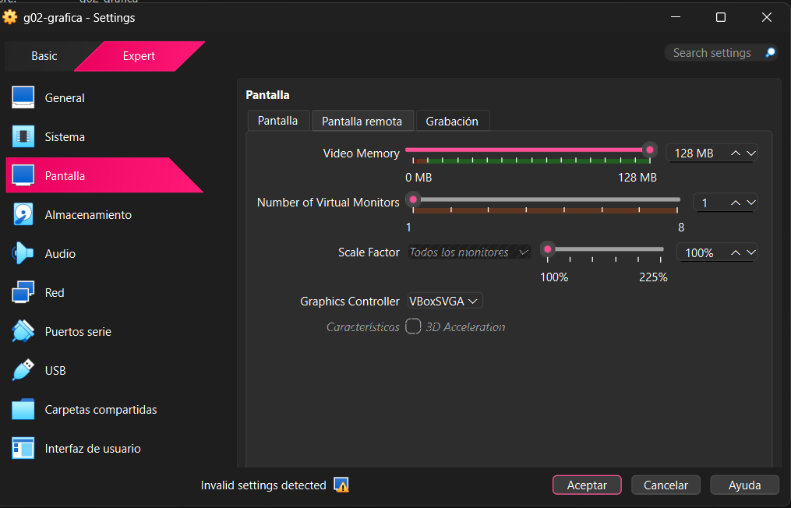
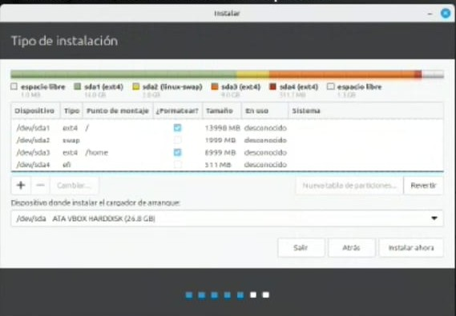
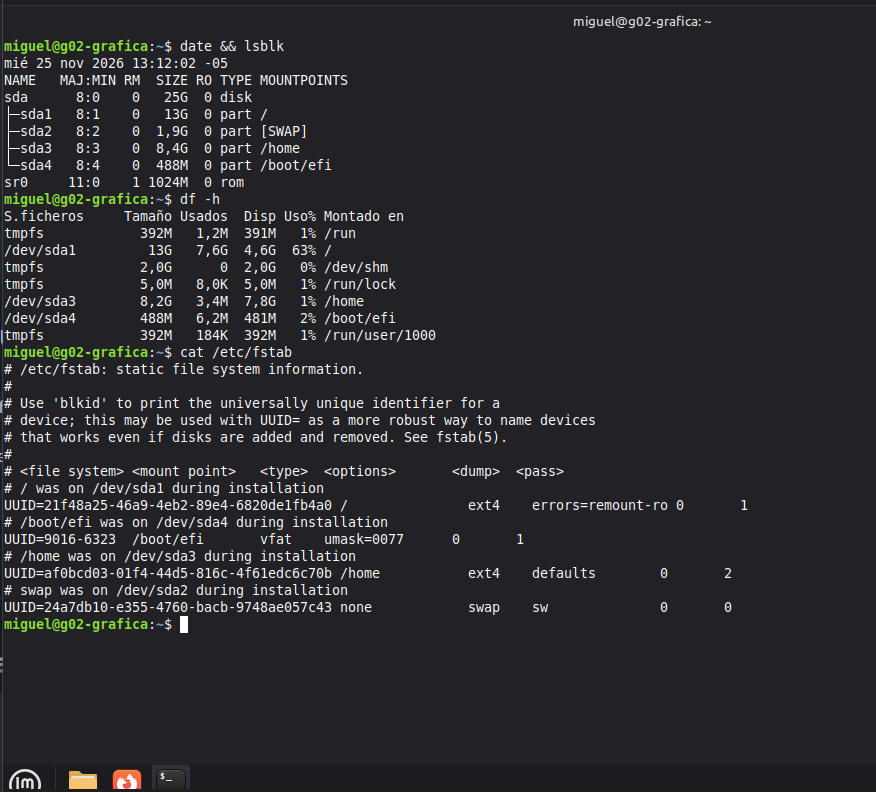
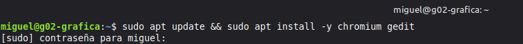
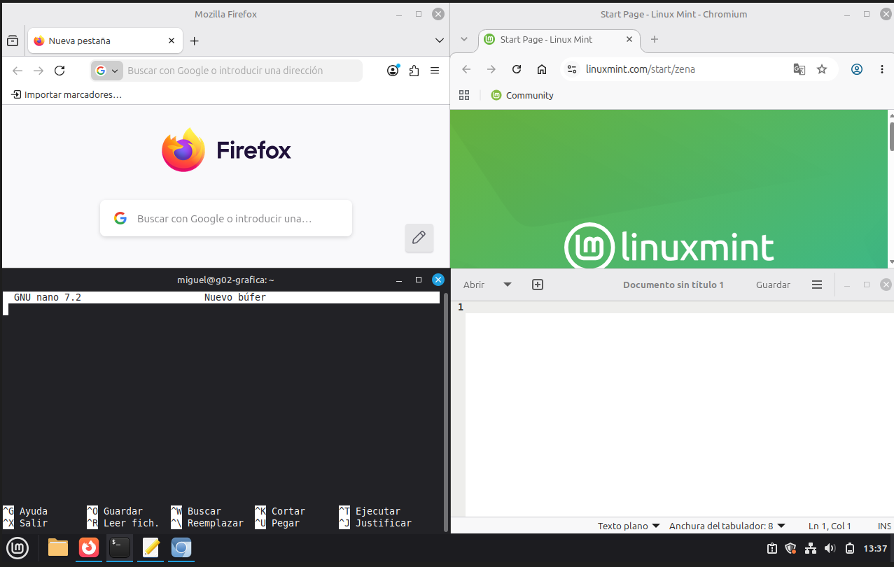

# Sprint 1 · Montaje

[Volver al inicio](./){: .volver}

## Video (máximo 3 minutos)

Video: pendiente de grabar y subir a YouTube.

<!--
Cuando tengan el video, borren la línea de arriba y pegan aquí el código de Insertar de YouTube:
<iframe width="560" height="315" src="https://www.youtube.com/embed/ID_DEL_VIDEO"
 title="Sprint 1" frameborder="0" allowfullscreen></iframe>
-->

## Referencia, adaptación y evidencias

1. **Referencia del docente:**
   [Consultar documento PDF](https://campusvirtual.univalle.edu.co/moodle/pluginfile.php/5371733/mod_resource/content/1/Proyecto%20Final%20Sistemas%20Operativos%202026%20Sem_2_V11.pdf)
   [Consultar proyecto de referencia](https://joalcasta-uv.github.io/so-proyecto-final-demo/sprint-1.html)
   [Consultar guía PDF](https://campusvirtual.univalle.edu.co/moodle/pluginfile.php/5371014/mod_resource/content/1/2.%20Guia_Particionamiento_y_Sistemas_de_Archivos.pdf)
2. **Lo que investigamos y adaptamos:** Investigamos el proceso de instalación de Linux Mint 22.3 Cinnamon en una máquina virtual utilizando Oracle VirtualBox. También consultamos información sobre los requisitos de hardware, la asignación de memoria RAM y procesadores, la configuración gráfica y el particionado manual del disco.
3. **Evidencias:** los cinco puntos siguientes.

---

## 1. VM gráfica (g02-grafica)

**Qué hicimos:** Creamos una máquina virtual llamada `g02-grafica` utilizando Oracle VirtualBox e instalamos Linux Mint 22.3 Cinnamon de 64 bits. Configuramos 4 GB de memoria RAM, 2 procesadores y un disco virtual de 25 GB. Durante la instalación realizamos un particionado manual del disco, asignando espacios independientes para el sistema raíz (`/`), la memoria de intercambio (`swap`), los archivos personales (`/home`) y el arranque (`/boot/efi`). Finalmente, verificamos las particiones desde la terminal e instalamos Chromium y gedit para contar con dos navegadores y dos editores de texto.

### Paso 1. Instalación de recursos


ISO descargada (`linuxmint-22.3-cinnamon-64bit.iso`) y VirtualBox instalado desde su página oficial (`https://www.virtualbox.org/wiki/Downloads`).

### Paso 2. Creación de la máquina virtual

**2.1 Asignación de nombre**



VM creada con el nombre `g02-grafica` y la ISO de Linux Mint 22.3 Cinnamon de 64 bits.

**2.2 Especificaciones de hardware**


Asignamos los siguientes recursos de hardware a la máquina virtual:

- Memoria RAM: 4096 MB (4 GB).
- Procesadores: 2 CPU.
- Disco duro virtual: 25 GB.

Se asignaron 4 GB de RAM para permitir el funcionamiento adecuado de Linux Mint con su entorno gráfico y las aplicaciones necesarias para el proyecto. Se utilizaron 2 procesadores virtuales para distribuir las tareas del sistema y se reservó un disco de 25 GB para instalar el sistema operativo, sus aplicaciones y los archivos personales.

Esta configuración permite ejecutar la máquina virtual sin asignarle todos los recursos disponibles del equipo anfitrión.

### Paso 3. Configuración de la pantalla



Configuramos la memoria de video en 128 MB y seleccionamos el controlador gráfico VBoxSVGA.

Se utilizó esta configuración para proporcionar los recursos gráficos necesarios para el entorno de escritorio Cinnamon de Linux Mint y mejorar la compatibilidad de la máquina virtual con su interfaz gráfica.

### Paso 4. Editor de particiones durante la instalación



### Paso 5. Particiones verificadas en la terminal

**Comandos:**

```
date && lsblk
df -h
cat /etc/fstab
```



Particiones creadas: `/` (13 GB), swap (1,9 GB), `/home` (8,4 GB) y `/boot/efi` (488 MB).

**Explicación de cada partición (razón del tamaño):**

1. `/`: (13 GB): Es la partición raíz donde se instala Linux Mint, sus archivos principales, bibliotecas y programas. Se asignaron 13 GB para disponer de espacio suficiente para el funcionamiento del sistema y la instalación de aplicaciones.
2. swap: (1,9 GB): Es el espacio de intercambio que utiliza Linux cuando necesita complementar la memoria RAM. Se asignaron aproximadamente 1,9 GB para apoyar la administración de memoria y permitir la transferencia temporal de datos entre la RAM y el disco.
3. `/home`: (8,4 GB): Almacena los archivos personales, documentos, descargas y configuraciones de los usuarios. Se asignaron 8,4 GB para mantener los datos personales separados de los archivos principales del sistema.
4. `/boot/efi`:  (488 MB): Es la partición destinada a almacenar los archivos necesarios para el arranque del sistema mediante UEFI. Se asignaron 488 MB para disponer de espacio suficiente para los archivos de arranque.

### Paso 6. Dos navegadores y dos editores

**Comando:**





Firefox: navegador web que ya venía instalado con Linux Mint.
Chromium: segundo navegador, instalado mediante la terminal.
Nano: editor de texto que ya estaba disponible en el sistema y funciona desde la terminal.
gedit: editor de texto gráfico instalado mediante el gestor de paquetes APT.

Para instalar las aplicaciones ejecutamos:
sudo apt update
sudo apt install -y chromium gedit

El primer comando actualiza la información de los repositorios y el segundo instala Chromium y gedit junto con sus dependencias.
Finalmente, abrimos simultáneamente Firefox, Chromium, Nano y gedit para comprobar que las cuatro aplicaciones funcionaban correctamente.

---
## 2. VM de consola (g02-consola)

**Qué hicimos:** <mark>COMPLETAR</mark> (disco de 25 GB y 2 CPU; particionado manual con `/`, swap, `/home` y `/var`; make, rsync, curl, git y wget)

**Comandos:**

```
COMPLETAR
```

**Captura:** <mark>COMPLETAR</mark>

**Explicación de cada partición:** <mark>COMPLETAR</mark>

---

## 3. Red

**Qué hicimos:** <mark>COMPLETAR</mark> (adaptador 1 en NAT y adaptador 2 en solo-anfitrión)

**Comandos:**

```
COMPLETAR (ip a en cada VM y ping en los dos sentidos)
```

**Captura:** <mark>COMPLETAR</mark>

---

## 4. SSH

**Qué hicimos:** <mark>COMPLETAR</mark> (entrar por SSH desde g02-grafica a g02-consola)

**Comandos:**

```
COMPLETAR
```

**Captura:** <mark>COMPLETAR</mark>

---

## 5. Instantáneas

**Qué hicimos:** <mark>COMPLETAR</mark> (una por VM, llamada `instalacion-limpia`, con la VM apagada)

**Captura:** <mark>COMPLETAR</mark>

---

## Errores y soluciones

<mark>COMPLETAR</mark> (error, causa probable, solución aplicada y fuente con título, enlace y fecha de consulta)
