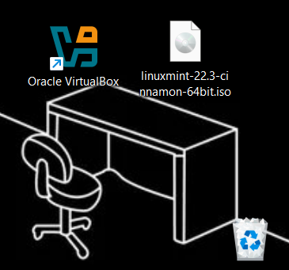
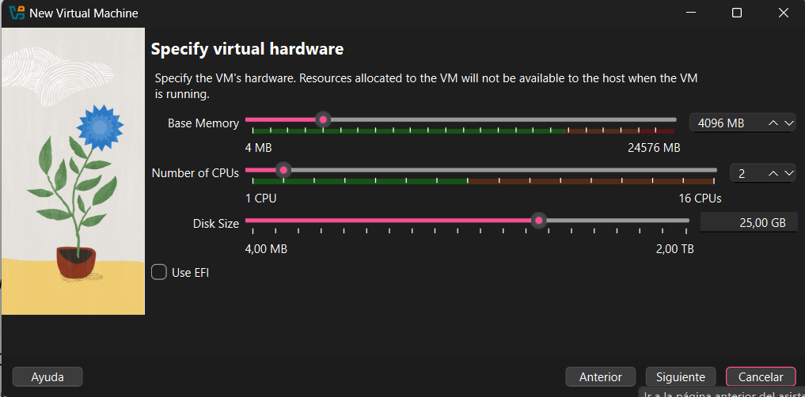

# Sprint 1 · Montaje

[Volver al inicio](./){: .volver}

## Video (máximo 3 minutos)

Video: pendiente de grabar y subir a YouTube.

<!--
Cuando tengan el video, borren la línea de arriba y pegan aquí el código de Insertar de YouTube:
<iframe width="560" height="315" src="https://www.youtube.com/embed/ID_DEL_VIDEO"
 title="Sprint 1" frameborder="0" allowfullscreen></iframe>
-->

## Referencia, adaptación y evidencias

1. **Referencia del docente:** COMPLETAR (guías de la clase que usaron)
2. **Lo que investigamos y adaptamos:** COMPLETAR
3. **Evidencias:** los cinco puntos de abajo

---

## 1. VM gráfica (g02-grafica)

**Qué hicimos:** COMPLETAR (particionado manual con `/`, swap y `/home`; dos navegadores y dos editores; una frase por partición con la razón de su tamaño)

**Avance hasta ahora**



ISO descargada: `linuxmint-22.3-cinnamon-64bit.iso`.


VM creada con el nombre `g02-grafica`.



Hardware: 4096 MB de RAM, 2 CPU y 25 GB de disco. Motivo de la RAM: COMPLETAR


Pantalla: 128 MB de memoria de video y controlador VBoxSVGA.

**Comandos:**

```
COMPLETAR (lsblk, df -h y cat /etc/fstab, con prompt y date)
```

**Explicación de cada partición:** COMPLETAR

---

## 2. VM de consola (g02-consola)

**Qué hicimos:** COMPLETAR (disco de 25 GB y 2 CPU; particionado manual con `/`, swap, `/home` y `/var`; make, rsync, curl, git y wget)

**Comandos:**

```
COMPLETAR
```

**Captura:** COMPLETAR

**Explicación de cada partición:** COMPLETAR

---

## 3. Red

**Qué hicimos:** COMPLETAR (adaptador 1 en NAT y adaptador 2 en solo-anfitrión)

**Comandos:**

```
COMPLETAR (ip a en cada VM y ping en los dos sentidos)
```

**Captura:** COMPLETAR

---

## 4. SSH

**Qué hicimos:** COMPLETAR (entrar por SSH desde g02-grafica a g02-consola)

**Comandos:**

```
COMPLETAR
```

**Captura:** COMPLETAR

---

## 5. Instantáneas

**Qué hicimos:** COMPLETAR (una por VM, llamada `instalacion-limpia`, con la VM apagada)

**Captura:** COMPLETAR

---

## Errores y soluciones

COMPLETAR (error, causa probable, solución aplicada y fuente con título, enlace y fecha de consulta)
